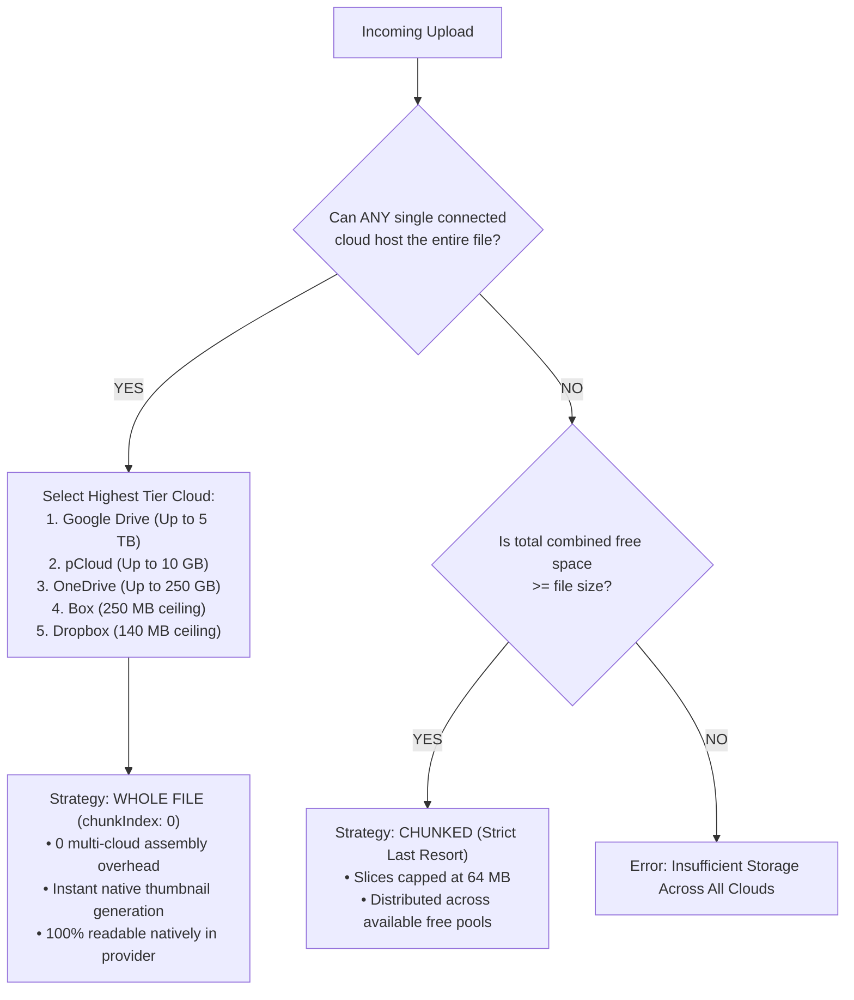
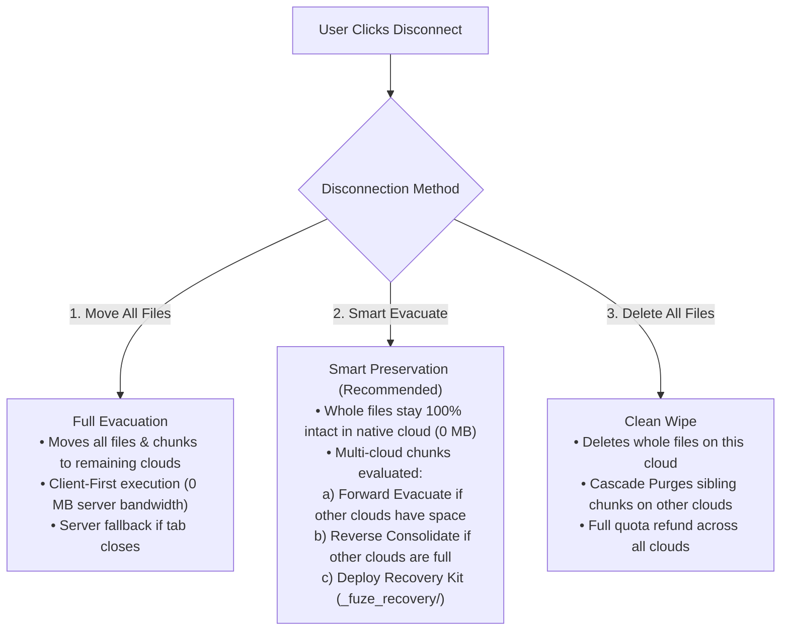
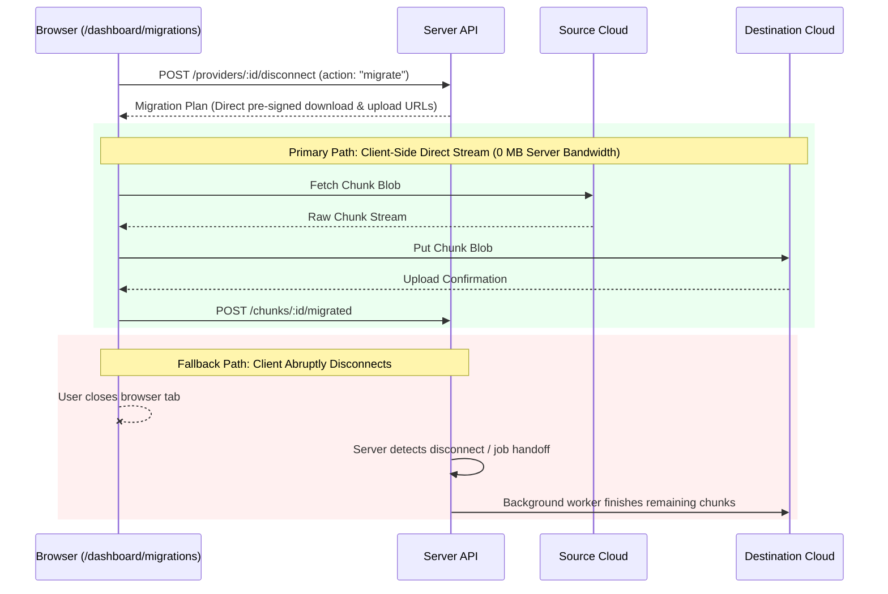

# Fuze Cloud Migration & Storage Strategy

This document outlines the technical architecture, execution flows, and failure recovery protocols for storage allocation, cloud provider disconnection, and data migration in the Fuze platform.

---

## 1. Core Architectural Pillars

1. **Zero Unnecessary Bandwidth**:
   - The server acts as a coordinator, scheduler, and planner. 
   - Files are stored as whole objects whenever possible so that disconnection uses **0 MB** of server transfer bandwidth.
2. **Data Sovereignty & Preservation**:
   - Disconnecting a cloud provider must never destroy or scatter a user's personal files. 
   - Whole files remain in the native cloud, readable outside Fuze without proprietary tools.
3. **Storage Hygiene (Zero Ghost Chunks)**:
   - Incomplete or orphaned file fragments are never left behind to permanently consume quota on remaining clouds.
4. **Non-Destructive Reconnection**:
   - Reconnecting a cloud provider never deletes un-indexed files; broken or incomplete chunks are simply ignored and left untouched in the user's personal cloud.

---

## 2. Upload Strategy: 99% Whole File Prioritization

To prevent unnecessary segmentation, Fuze prioritizes storing files as single, whole objects.

### Decision Algorithm (`ChunkDecisionService.ts`)



### Provider Ceilings & Priority Weights:
- **Google Drive**: Ceiling: 5 TB | Priority: 100 *(Primary target for large media/archives)*
- **pCloud**: Ceiling: 10 GB | Priority: 95
- **OneDrive**: Ceiling: 250 GB | Priority: 90
- **Box**: Ceiling: 250 MB | Priority: 85
- **Dropbox**: Ceiling: 140 MB | Priority: 70

---

## 3. Disconnection Strategies (The 3 Options)

When a user initiates account disconnection via `DisconnectModal.tsx`, Fuze presents 3 distinct strategies:



---

### Strategy 1: Move All Files (`action: "migrate"`)
- **Objective**: Evacuate all content from this provider to remaining connected accounts so Fuze Drive remains 100% intact.
- **Execution**:
  - **Client-First**: The browser streams chunks directly from Cloud A to Cloud B using direct pre-signed URLs.
  - **Server Fallback**: If the client closes the browser or disconnects, the server background worker picks up the job to prevent data loss.
- **Fail-Safe**: If remaining clouds run out of capacity or reject a chunk due to file size limits, **Cascade Purge** cleans up that specific unsalvageable file rather than freezing the system.

---

### Strategy 2: Smart Evacuate (`action: "smart_unlink"`) — *Recommended*
- **Objective**: Preserve files in the native cloud without transferring hundreds of megabytes.
- **Execution Rules**:
  1. **Whole Files (`totalChunks === 1`)**:
     - Left **100% intact** in the cloud account (e.g., inside Dropbox/Google Drive).
     - Removed from the Fuze database index.
     - **Bandwidth used**: 0 MB.
  2. **Chunked Files (`totalChunks > 1`)**:
     - **Case A: All Chunks Already on This Cloud**:
       - 0 MB transfer needed.
       - Chunks remain in the cloud.
       - Fuze deploys `_fuze_recovery/` with 1-click restore scripts.
     - **Case B: Chunks Split Across Clouds (Forward Attempt)**:
       - Fuze moves the chunk to remaining connected clouds if they have sufficient free quota.
     - **Case C: Remaining Clouds Full (Reverse Consolidation)**:
       - Fuze pulls the missing pieces from the remaining clouds into this disconnecting provider.
       - Frees up storage on the remaining clouds.
       - Consolidates all parts into this provider alongside the Recovery Kit.
     - **Case D: Both Clouds Full (Cascade Purge)**:
       - If neither cloud can hold the complete file, Cascade Purge cleans up orphan fragments to refund quota.

---

### Strategy 3: Delete All Files (`action: "delete"`)
- **Objective**: Clean wipe of all data from this provider.
- **Execution Rules**:
  1. **Whole Files**: Physically deleted from the cloud provider via storage adapter API.
  2. **Multi-Cloud Split Chunks**: Deletes local chunks, then triggers **Cascade Purge** on remaining clouds to delete sibling chunks and refund their quota.

---

## 4. Cascade Orphan Purge (`CascadePurgeService.ts`)

### The "Ghost Chunk" Problem:
If a file was split across Dropbox (Chunk 1) and Google Drive (Chunk 2), and Dropbox is disconnected or wiped:
- Chunk 1 is gone; the file can **never** be reassembled or downloaded.
- Without Cascade Purge, Chunk 2 would sit on Google Drive forever, wasting user quota.

### How Cascade Purge Solves It:
1. Locates all sibling chunks belonging to the dead file across remaining clouds.
2. Calls `adapter.deleteFile()` on those other clouds to physically delete the orphan chunks.
3. Decrements `quotaUsed` on those clouds to **refund the user's storage**.
4. Deletes the database records (`fileChunks` and `vfsNodes`).
5. Emits `FILE_DELETED` via WebSocket to update the frontend.

---

## 5. Self-Recovery Kit Architecture (`_fuze_recovery/`)

Whenever an unlinked provider retains chunked files, Fuze deploys a self-contained recovery directory directly into that cloud account:

```
📁 User's Cloud Account Root
 ├── 📄 my_document.pdf               (Whole file - opens natively)
 ├── 📄 video_a8f3.part0.mp4          (Chunk 1 of 3)
 ├── 📄 video_a8f3.part1.mp4          (Chunk 2 of 3)
 ├── 📄 video_a8f3.part2.mp4          (Chunk 3 of 3)
 └── 📁 _fuze_recovery/               (Automated Recovery Kit)
      ├── 📄 RESTORE_ALL_FILES.bat    (1-Click Windows Runner)
      ├── 📄 RESTORE_ALL_FILES.sh     (1-Click Mac/Linux Runner)
      └── 📄 RECOVERY_INSTRUCTIONS.txt(Human-readable Inventory)
```

### Safety Features of the Recovery Script:
- **Pre-Flight Part Verification**: The script checks `if not exist "partX" set MISSING=1` before attempting concatenation. It refuses to create truncated or corrupt files.
- **Split Multi-Cloud Identification**: If a chunk lives on another cloud (e.g. Google Drive), `RECOVERY_INSTRUCTIONS.txt` lists the exact external provider and account email so the user knows where to find missing parts.
- **Zero-Dependency Native Concatenation**:
  - Windows: `copy /b part0 + part1 + part2 "output.mp4"`
  - Mac/Linux: `cat part0 part1 part2 > "output.mp4"`

---

## 6. Reconnection & Storage Hygiene (Non-Destructive)

When a user reconnects an account (e.g. re-linking Dropbox):

1. **Reconciliation Scan**: Fuze inspects the `/Fuze` folder and matches remote files against database records.
2. **Complete Healthy Files**: Automatically re-indexed into Fuze VFS (`ACTIVE`). Zero bandwidth used.
3. **Incomplete / Orphan Chunks ("Garbage Files")**:
   - **Never Deleted Automatically**: To protect user data, Fuze never deletes unrecognized or incomplete chunks without explicit consent.
   - **Excluded from App**: These chunks are simply ignored and omitted from the VFS tree.
   - **User Notification**: An informational badge notifies the user:
     > *"We detected incomplete files from a previous session. They were not imported and remain untouched in your personal cloud."*

---

## 7. Execution Engine: Hybrid Model



### Infrastructure Context:
- **Oracle Cloud Always Free Tier**: 4 OCPU ARM, 24 GB RAM, 10 TB monthly outbound bandwidth, 24/7 continuous uptime.
- Even with abundant server bandwidth, **Smart Preservation (Whole files stay in place)** remains the primary strategy because it eliminates latency (< 1s disconnect) and avoids cloud provider API throttling (HTTP 429).
